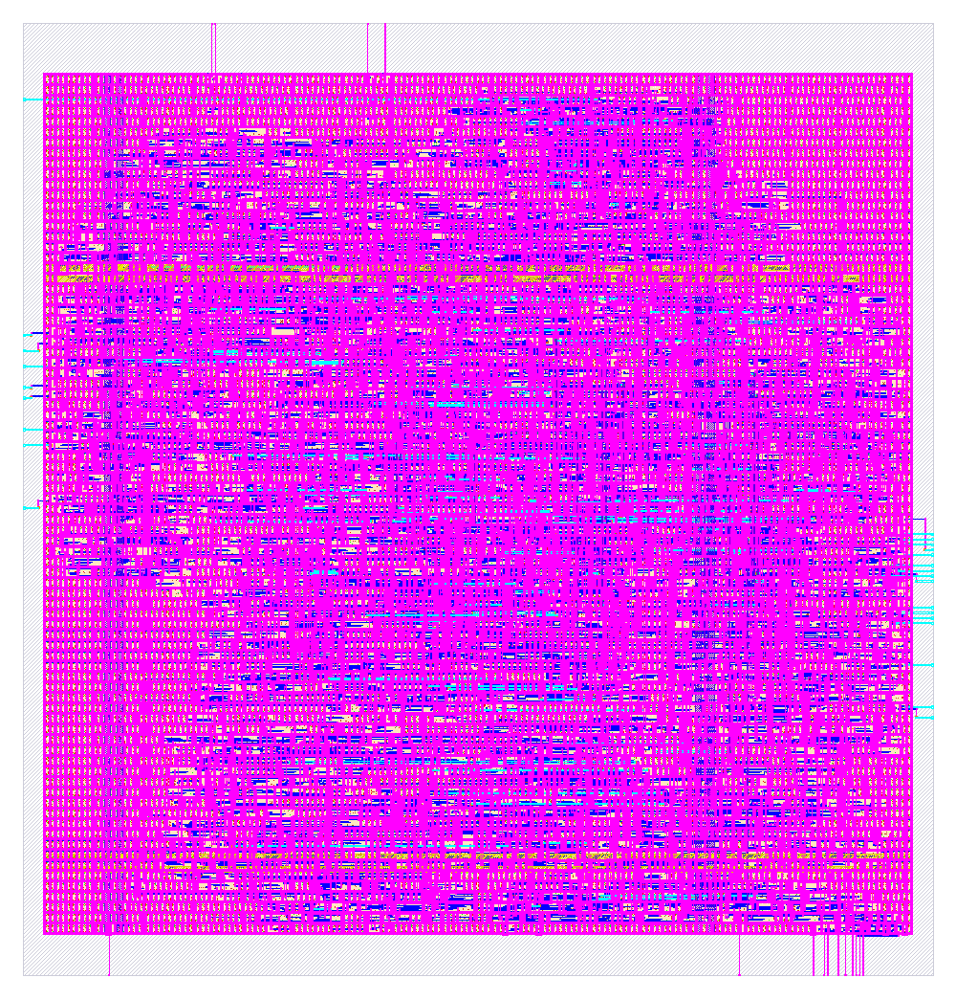

# jev4

`jev4` is a hardened hard macro for SkyWater SKY130 (`sky130_fd_sc_hd`). This package contains two views:

| File | What it is |
|---|---|
| `lef/jev4.lef` | Abstract physical view (LEF 5.7) for place and route |
| `vh/jev4.vh` | Verilog blackbox. Its signal ports match `rtl/jev4.v` |
| `rtl/jev4.v` / `rtl/jev4.vhd` | Generated RTL in Verilog and VHDL |
| `rtl/jev4_tb.v` / `rtl/jev4_tb.vhd` | Self-checking testbenches (16 golden vectors) |
| `gds/jev4.gds` | Hardened layout |
| `jev4.png` | Picture of that layout |
| `metrics.json` | Signoff metrics for the hardening run |
| `lib/` | Nine liberty corners: min, nom, and max, each at ff −40 °C 1.95 V, ss 100 °C 1.60 V, and tt 25 °C 1.80 V |
| `librelane/config.json` | OpenLane config used for the run. Clock period 25 ns |

## Macro summary

| Property | Value |
|---|---|
| Class | `BLOCK` |
| Size | 236.535 µm × 247.255 µm (origin 0, 0) |
| Signal pins | 40 (11 input bits, 29 output bits) |
| Power | `VPWR` and `VGND`, 2 vertical met4 straps each, running y = 10.64 to 234.16 µm, and 2 horizontal met5 straps each |
| Pin layers | met2 on the north (4) and south (11) edges, met3 on the east (16) and west (9) edges |
| Obstructions | nwell, li1, and met1 cover the core. met2, met3, and met4 are partly blocked; see `OBS` in the LEF |
| Signoff | Corner `max_ss_100C_1v60`. Worst setup slack 6.517 ns. Worst hold slack 0.930 ns. Slew, capacitance, fanout, route DRC, Magic DRC, KLayout DRC, and LVS are 0 |

## Ports

| Port | Dir | Width | Notes |
|---|---|---|---|
| `clk` | in | 1 | Clock. One instruction byte per clock |
| `rst` | in | 1 | Synchronous reset, active high |
| `rom_in0` | in | 4 | Nibble read from input port 0 |
| `rom_in1` | in | 4 | Nibble read from input port 1 |
| `test` | in | 1 | Test input |
| `acc` | out | 4 | Accumulator |
| `cy` | out | 1 | Carry |
| `pc` | out | 12 | Program counter |
| `rom_out0` | out | 4 | Nibble written to output port 0 |
| `rom_out1` | out | 4 | Nibble written to output port 1 |
| `ram_out` | out | 4 | Nibble written to the data port |
| `VPWR`, `VGND` | inout | 1 | Only when `USE_POWER_PINS` is defined |



## How it works

This section was traced from the gate netlist in `rtl/jev4.v` and from the port list in `vh/jev4.vh`.

**The machine.** `jev4` is a 4-bit controller. The program store is 256 bytes, inside the macro. Each clock takes one byte from that store. An instruction that is two bytes long takes two clocks. The program counter `pc` is 12 bits. The store is addressed with the low 8 bits, so the address wraps at 256.

**The pins.** `acc` is the 4-bit accumulator and `cy` is the carry. `test` is a 1-bit input. `rom_in0` and `rom_in1` are the 4-bit words read from the two input ports. `rom_out0` and `rom_out1` are the 4-bit words written to those ports. `ram_out` is the 4-bit word written to the data port. The output nibbles are registered.

**Reset.** `rst` is synchronous and active high. It loads the initial state. The testbench holds reset for one cycle, then runs 300 cycles with `rom_in0`, `rom_in1`, and `test` held, and checks `acc`, `cy`, `pc`, `rom_out0`, `rom_out1`, and `ram_out`.

## RTL

The RTL comes from the WASMApollo EDA (heapvm vgpu apollo), generated from the typed fabric `jev4`. The Verilog and VHDL are the same design.

| Property | Value |
|---|---|
| LUT4 cells | 1311 |
| Word PEs | 0 |
| Registers | 231 |
| Combinational depth | 27 levels |
| Clocking | Single `clk`. Every register latches on the rising edge from the settled levels |
| Reset | `rst` is synchronous, active high, and loads the fabric's initial state |

### Microcode ROMs

The header of `rtl/jev4.v` lists the controller ROMs, and `rtl/jev4.vhd` lists the same ROMs. Each ROM maps the current instruction to the select code for that clock.

## Simulation

Both testbenches are self-checking. Each vector holds `rst` for one cycle, runs 300 cycles, and then compares every output against the fabric's golden model (RefSim).

```sh
# Verilog (Icarus), from rtl/
iverilog -o tb jev4.v jev4_tb.v && vvp tb
# expected: PASS jev4: 16 vectors

# VHDL (GHDL), from rtl/
ghdl -a jev4.vhd jev4_tb.vhd && ghdl -e jev4_tb && ghdl -r jev4_tb
```

The VHDL testbench was run with GHDL and passes all 16 vectors. The Icarus command above is the Verilog run.

## Using the macro

### In RTL

```verilog
`include "jev4.vh"

jev4 u_jev4 (
`ifdef USE_POWER_PINS
  .VPWR(vccd1),
  .VGND(vssd1),
`endif
  .clk(clk), .rst(rst),
  .rom_in0(rom_in0), .rom_in1(rom_in1), .test(test),
  .acc(acc), .cy(cy), .pc(pc),
  .rom_out0(rom_out0), .rom_out1(rom_out1), .ram_out(ram_out)
);
```

The blackbox file in this package is `vh/jev4.vh`. Define `USE_POWER_PINS` for power-aware simulation and LVS. Leave it undefined for plain RTL simulation.

### In OpenLane / OpenROAD

Add the LEF, the GDS, and the blackbox to your top-level config, for example:

```json
"EXTRA_LEFS": ["dir::lef/jev4.lef"],
"EXTRA_GDS_FILES": ["dir::gds/jev4.gds"],
"VERILOG_FILES_BLACKBOX": ["dir::vh/jev4.vh"]
```

Then connect `VPWR` and `VGND` to the power grid through the met4 and met5 straps. The GDS in this package is `gds/jev4.gds`.

## Other PDKs

The `VPWR`/`VGND` names belong to the hardened SKY130 view. To target another public PDK, synthesize `rtl/jev4.v` there and use that PDK's supply names. The LEF only applies to SKY130.
